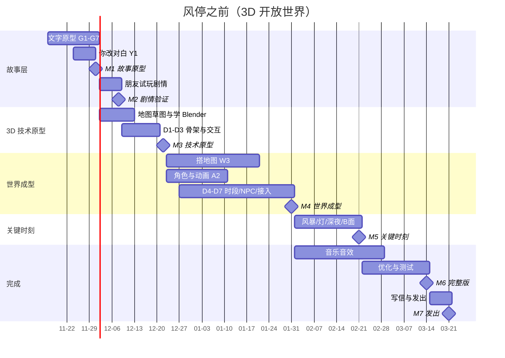

# 《风停之前》进度表（3D 开放世界版）

> 起始：2026-11-16　计划发出：2027-03-21（约 18 周）
> 状态：⬜ 未开始　🟨 进行中　✅ 完成　⛔ 阻塞
> 编号：G = 故事层　D = 3D 世界层代码　W = 地图搭建　A = 美术　S = 声音　T = 测试　L = 写信
> 提示词见 [风停之前_Grok提示词.md](风停之前_Grok提示词.md)

## 总览

> 下表中 11、12 月为 2026 年，1–3 月为 2027 年。

---

## 阶段 0：准备（11-17 ～ 11-18）

| ID | 任务 | 负责 | 依赖 | 开始 | 结束 | 状态 |
|---|---|---|---|---|---|---|
| P0-1 | 定游戏名、角色显示名 `heroName`、玩家默认称呼 | 你 | — | 11-17 | 11-17 | ⬜ |
| P0-2 | 安装 Blender（免费）；注册 Mixamo（免费） | 你 | — | 11-17 | 11-18 | ⬜ |
| P0-3 | 如果交给 Grok：开新对话，发 G0，附方案、计划书和现有代码 | 你 | — | 按需 | | ⬜ |

## 阶段 1：故事原型（11-16 ～ 12-01）

| ID | 任务 | 负责 | 依赖 | 开始 | 结束 | 状态 |
|---|---|---|---|---|---|---|
| G1 | 剧情引擎骨架、存档、配置、文字界面 | Claude | — | 11-16 | 11-16 | ✅ |
| G2 | 场景 1–2：清晨码头、上午旧街 | Claude | G1 | 11-16 | 11-16 | ✅ |
| G3 | 笔记本推理系统 + 场景 3–4（工作台、修好） | Claude | G1 | 11-16 | 11-16 | ✅ |
| G4 | 场景 5–7：傍晚、风暴（文字版）、信号站 | Claude | G1 | 11-16 | 11-16 | ✅ |
| G5 | 深夜工作台 + 沉默计时 | Claude | G1 | 11-16 | 11-16 | ✅ |
| G6 | 黎明、B 面、信、标题永久变化 | Claude | G2–G5 | 11-16 | 11-16 | ✅ |
| Y1 | **逐句改对白，改成自己说话的方式**（只改 `story/`） | 你 | 陆续 | 11-24 | 11-30 | ⬜ |
| G7 | 串联检查、手机适配、修 bug | Claude | G6 | 11-16 | 11-16 | ✅ |
| **M1** | **文字版可以从头玩到尾**（11-16 已达成；Y1 改对白和真机测试仍待你完成） | | | | **12-01** | ✅ |

## 阶段 1.5：剧情验证（12-02 ～ 12-08，与阶段 2 并行）

| ID | 任务 | 负责 | 依赖 | 开始 | 结束 | 状态 |
|---|---|---|---|---|---|---|
| T1 | 部署文字版，生成测试链接 | 你 | M1 | 12-02 | 12-02 | ⬜ |
| T2 | 2–3 位朋友试玩，按下方问题记录 | 你 | T1 | 12-03 | 12-07 | ⬜ |
| T3 | 汇总反馈，修改剧情（可以找 Claude 评审） | 你 | T2 | 12-08 | 12-08 | ⬜ |
| **M2** | **决策点：故事成立 → 继续；不成立 → 先改故事** | | | | **12-08** | ⬜ |

**验证问题：**
- [ ] 不看提示，能说出几件"他做了但没说"的事？（目标 ≥ 2）
- [ ] B 面开始时有没有明显反应？
- [ ] 深夜那场戏，有没有坐着等他开口？
- [ ] 对白像不像你？哪句不像？
- [ ] 哪里无聊、哪里卡住？
- [ ] 读完信后的反应？

## 阶段 2：3D 技术原型（12-02 ～ 12-22）

| ID | 任务 | 负责 | 依赖 | 开始 | 结束 | 状态 |
|---|---|---|---|---|---|---|
| W1 | 地图草图：俯视图，标出区域、主线路线、可选地点（可以手画拍照） | 你（Claude 可帮忙） | — | 12-02 | 12-04 | ⬜ |
| W2 | 学 Blender 的五个操作；挑定一套主素材包；搭一个**灰盒测试地图**（含几个 `hs_` `zone_` `spawn_`），导出 `world_test.glb` | 你 | P0-2 | 12-02 | 12-12 | ⬜ |
| A1 | 画风：参考图 + Grok 概念图 + 一张调色板 | 你 + Grok | — | 12-05 | 12-09 | ⬜ |
| D1 | 3D 骨架：Three.js 本地引入、渲染循环、灰盒地面、玩家胶囊体、虚拟摇杆、跟随镜头、画质分档、帧率显示 | Claude | — | 11-16 | 11-16 | ✅（真机帧率待测） |
| D2 | 加载 glb，按命名约定收集锚点，碰撞，出生点 | Claude | D1 | 11-16 | 11-16 | ✅（用生成的测试地图验证；你的 Blender 地图待测） |
| D3 | 交互层：靠近锚点出现交互键 → 调用剧情引擎；3D 画面上的对话框；`zone` 触发主线；3D / 文字模式切换 | Claude | D2 | 11-16 | 11-16 | ✅（第 2 场在 3D 里走通，flags 与文字模式一致） |
| T2b | 真机测试：你的手机和一台中端安卓机，帧率、发热、触控手感 | 你 | D3 | 12-21 | 12-22 | ⬜ |
| **M3** | **手机上能在灰盒小镇里走动、和物件对话，30 帧以上** | | | | **12-22** | ⬜ |

## 阶段 3：世界成型（12-23 ～ 01-31）

| ID | 任务 | 负责 | 依赖 | 开始 | 结束 | 状态 |
|---|---|---|---|---|---|---|
| W3 | **用 Blender 搭完整地图**：码头、旧街、工作台小屋、旧码头、海滩、山坡小路、信号站、防波堤与灯塔；放好全部锚点 | Codex（你确认） | — | 11-20 | 11-20 | 🟨 灰盒已通过 Claude 游戏内验收；待美化。任务书：`Codex_Blender地图任务.md`；检查：`node tools/check_map.mjs game/assets/town.glb` |
| A2 | 角色：他、玩家、居民 4–6 位、猫；动画：走、跑、蹲、坐、挥手、挠头、扛东西 | Codex | — | 11-20 | | 🟨 他和玩家已完成（原创，12 个动画）；奶奶、居民、猫待做 |
| A3 | **美术样片：深夜工作台**（精修小屋、烘焙光照、后期处理、真角色） | Codex + Claude | — | 11-20 | 11-20 | ✅ 待你在手机上确认方向 |
| D4 | 时段系统：8 套光照预设（太阳、环境光、雾、天空），平滑过渡；"场景 = 时段" | Claude | D3 | 11-18 | 11-18 | ✅ |
| D5 | 角色动画控制；NPC 与他的日程（`heroAt`，按时段在路径点间活动） | Claude | — | 11-20 | 11-20 | ✅（占位角色；A2 的真模型做好后填进 `story/cast.js`） |
| S0 | 开放世界文案：撞见他做事的 6–8 个事件、居民支线 2–4 条、坐下看海的独白 | Claude + 你 | M2 | 11-20 | | 🟨（第一批在旧街 s02：居民支线 3 条——邮递员→奶奶的信、补网的老周、风筝小孩；撞见他 1 个——海滩修风筝；长椅独白按条件变。B 面加 3 张卡片、他的笔记本加 3 条。待你改对白；更多撞见事件需要地图加锚点：礁石、灯塔、防波堤） |
| D6 | 开放世界引导：他招手、笔记本"现在想做的事"、迷路时他出现在附近；坐下系统；辅助模式自动寻路 | Claude | D5 | 11-20 | 11-20 | ✅ |
| D7 | 接入完整地图和全部剧情，从头走到尾（关键时刻先用占位） | Grok + 你 | W3, D5, D6 | 01-21 | 01-31 | ⬜ |
| **M4** | **完整世界可以从头玩到尾** | | | | **01-31** | ⬜ |

## 阶段 4：关键时刻（02-01 ～ 02-21）

| ID | 任务 | 负责 | 依赖 | 开始 | 结束 | 状态 |
|---|---|---|---|---|---|---|
| D8 | 风暴段 3D：浪的节奏和预警、雨、风；断桥握手；扛电池负重 | Claude | — | 11-20 | 11-20 | ✅（测试地图上验证；真地图需要放同名锚点） |
| D9 | 灯一盏盏亮（`win_` 窗户由近及远）；深夜全镇变暗、工作台唯一光源、推镜；接入沉默计时 | Claude | — | 11-20 | 11-20 | ✅ |
| D10 | B 面：镜头沿当天路线飞行，在他做事的地点重放动作；信；标题画面换成世界本身（夜 / 天亮） | Claude | D9 | 11-20 | 11-20 | ✅（B 面逐张 3D 回放；片尾台灯熄灭） |
| W4 | **整图美化 + 奶奶、猫、居民角色**（按美术样片标准，分 5 批） | Codex + Claude | A3 | 11-20 | 11-20 | ✅ 已接入游戏：7 个角色、5 组烘焙光、路灯/风铃/晾衣/信号灯/接线盒盖；分块合并后各处 ≤ 106 次绘制、≤ 76k 三角面 |
| R1 | 写实画面（代码）：保留物理材质 + 按名字修正粗糙度、天空环境反射随时段变、过肩低机位窄视角、对话景深、角落暗部（GTAO）、胶片调色（颗粒/色散/对比曲线）；画质高全开、中只开材质和反射、低保持原样；`?look=classic` 对比 | Claude | — | 11-21 | 11-21 | ✅（电脑上验证：全部效果 4.6ms/帧 vs 关闭 3.9ms；手机帧率待测） |
| R2 | 写实贴图与场景细节：Poly Haven / ambientCG 扫描贴图、贴花、杂物、全局光照重烘焙（见 `Codex_写实化任务.md`） | Codex | R1 | 11-21 | | 🟨（R2-A 物理材质 ✅；R2-B 生活细节 ✅ 已验收：119,595 面、32 材质、24.4 MB，所有路线和辅助自动走通过；杂物返工 ✅（写实面包、浮标、贝笼，加外挂楼梯、雨棚、手推车；131,507 面、23.2 MB，路线全部通过）；R2-C 重烘焙 ✅（新 AO + 5 张反弹光 GI + 小屋夜图，lightmaps 共 7 MB；GI 烘得偏暗，游戏里乘 16 并压低该表面的天空环境光才看得出，强度跟着时段走，深夜几乎关掉；11-21 补：80 个 R2-B 道具也接上烘焙光照，地图 23.8 MB、光照贴图 7.2 MB）） |
| R3 | 写实比例角色：MPFB2（MakeHuman）重做 7 个角色，沿用 12 个动画名 | Codex | R1 | 11-21 | | ✅（11-21 全部验收：他、女版 / 男版玩家、奶奶、老周、小孩、邮递员用 MPFB2 写实比例 + Mixamo 移动动作；灰猫原创写实；三档移动、跑步转身、转头看人已接入；全部模型已压缩，动作逐骨核对无差别） |
| R4 | 第二轮质感（Claude 直接做，不再交 Codex）：真实云层天空 ✅；动态海（海浪、反射、浅水、岸边白浪，码头石墙边是深水）✅；山坡草地（约 15 万丛，镜头附近才画，随风摆）✅；EZ-Tree 写实树木和灌木 207 棵，远处换简化版，随风摆 ✅；Poly Haven 扫描礁石 70 块 ✅；风暴改成 GTA 式灰色雨天（看得清房子、地面变湿、雨幕更密，自由走动时背景不虚化）✅；Rocketbox 写实人物：男版玩家、老周（Claude）+ 小孩、邮递员、女版玩家、主角（Codex R5，主角选 Male_Adult_10）全部换成 Rocketbox 写实人物 ✅（tools/build_rocketbox.sh 一条龙）；奶奶用 Female_Adult_09 改花白头发 + 驼背（tools/rocketbox_variant.py）✅；只有猫还是旧模型 | Claude | R3 | 11-21 | | 🟨 |
| **M5** | **所有关键时刻完成** | | | | **02-21** | ⬜ |

## 阶段 5：声音、优化、测试（02-01 ～ 03-14）

| ID | 任务 | 负责 | 依赖 | 开始 | 结束 | 状态 |
|---|---|---|---|---|---|---|
| S1 | 主旋律三版本：轻快 / 钢琴慢版 / 完整版（约朋友作曲，或用可商用授权曲） | 你 | — | 02-01 | 02-28 | ⬜ |
| S2 | 环境音：海浪、风、雨、脚步（沙 / 木 / 石）、收音机、键盘、猫、风铃 | 你 | — | 02-15 | 02-28 | ⬜ |
| D11 | 音频系统：首次点击后才播放、按区域混音、3D 定位音效、切后台暂停 | Claude | S2 | 11-20 | 11-20 | ✅（全部 Web Audio 现场合成，无音频文件：海/风/雨/鸟、屋里变闷、脚步木/地、雷随闪电、浪拍、风铃按距离、滴/嗡/咔哒/广播/键盘；原创主旋律 light/night/full；菜单开关。剧情字段 music/sfx/indoor 见 js/audio/audio.js 顶部） |
| D12 | 性能优化与兼容：按区域加载资源、贴图压缩、iOS Safari / 安卓 Chrome 修复 | Grok + 你 | M5 | 02-27 | 03-07 | 🟨（11-21：带烘焙光照的物体参与合并；装了 gltf-transform（tools/node_tools，不进游戏）：地图贴图转 WebP + 几何 meshopt 无损压缩 24.9 → 12.1 MB，画面和所有路线不变；光照贴图转 WebP 7.5 → 5.2 MB（GI 无损）；他 / 女版 / 男版玩家 2.4 → 1.5 MB，动作逐骨核对无差别。脚本：tools/compress_glb.mjs、tools/compress_lightmaps.mjs，原文件备份在 tools/backup。其余 5 个角色也已压缩；整局资源下载 44 → 26.4 MB；剩余：手机实测、按需给中 / 低画质更小的贴图） |
| T4 | 第二轮试玩（3D 版，可以换新朋友） | 你 | D12 | 03-08 | 03-12 | ⬜ |
| D13 | 修复第二轮试玩发现的问题 | Grok / Claude | T4 | 03-12 | 03-14 | ⬜ |
| **M6** | **完整版** | | | | **03-14** | ⬜ |

## 阶段 6：写信与发出（03-15 ～ 03-21）

| ID | 任务 | 负责 | 依赖 | 开始 | 结束 | 状态 |
|---|---|---|---|---|---|---|
| L1 | 确定名单；确认每个人都可以看到深夜那场戏 | 你 | — | 03-15 | 03-15 | ⬜ |
| L2 | **每人一封信**（手写扫描，≤ 200 字，写一件对方为你做过的具体小事）+ 填彩蛋配置 | 你 | L1 | 03-15 | 03-19 | ⬜ |
| D14 | 专属链接生成脚本、noindex、最终检查清单 | Grok / Claude | M6 | 03-20 | 03-20 | ✅（11-21：tools/build_release.mjs 打包到 dist/ + friends/链接清单.txt；每人随机 16 位链接、信件图片随机名、noindex + robots.txt、发布版关测试开关；用两个假朋友测过两种信、无链接和错链接；说明见 发布指南.md 和 friends/README.md） |
| **M7** | **发出** | 你 | L2, D14 | | **03-21** | ⬜ |

---

## 每两周检查

| 检查日 | 应该完成 | 实际 | 备注 |
|---|---|---|---|
| 11-29 | G3–G6 | | |
| 12-13 | M1、M2、W1、A1、D1 | | |
| 12-27 | M3、D4 开始 | | |
| 01-10 | A2、D5、W3 过半 | | |
| 01-24 | W3、D6、S0 | | |
| 02-07 | M4、D8 | | |
| 02-21 | M5 | | |
| 03-07 | D11、D12、S1、S2 | | |
| 03-21 | M6、L2、M7 发出 | | |

**砍内容的顺序**（进度落后两周以上时，从上往下砍）：
1. 后山小树林
2. 居民支线砍到 2 条
3. 防波堤与灯塔
4. 二周目暖光
5. 画质"高"档的额外效果
